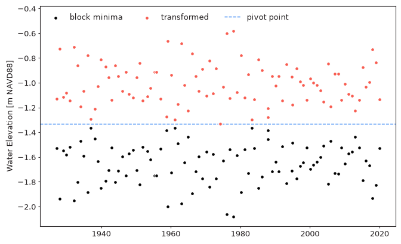
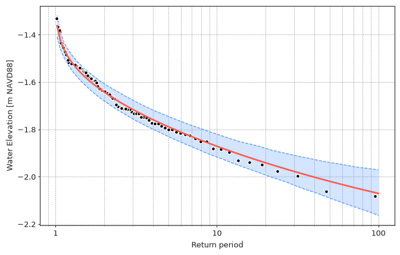

Extreme value theory and the distributions used in EVA (GEVD, GPD, and their
degenerate cases) describe extreme **high** values: the right tail of
a distribution. Extreme **low** values, such as block minima or peaks below
a threshold (see [Block Maxima](../user-guide/3-block-maxima.md#block-minima) and
[Peaks Over Threshold](../user-guide/4-peaks-over-threshold.md#peaks-below-threshold)),
are analyzed by transforming them into extreme high values, fitting a model,
and transforming the results back.

## Transformation

The transformation reflects the extreme values around a **pivot point**,
which is the largest of the extreme low values:

$$x' = 2 x_{pivot} - x$$

After the transformation the most extreme (lowest) values become the largest ones,
while the values stay in the same units and in the same range as the original data.
Applying the same formula again returns the original values.
The transformation is implemented in the `ExtremesTransformer` class:

```python
from pyextremes.extremes import ExtremesTransformer

transformer = ExtremesTransformer(extremes=extremes, extremes_type="low")
transformer.pivot_point  # -1.331
transformer.transformed_extremes  # reflected extremes
transformer.transform(-2.0)  # transform any value in either direction
```

<figure markdown="span">
  
</figure>

??? note
    You can get the `data` and `extremes` variables referenced in this section
    by running the following code:

    ```python
    import pandas as pd
    from pyextremes import get_extremes

    data = pd.read_csv(
        "battery_wl.csv",
        index_col=0,
        parse_dates=True,
    ).squeeze()
    data = (
        data
        .sort_index(ascending=True)
        .astype(float)
        .dropna()
        .loc[pd.to_datetime("1925"):]
    )
    data = (
        data
        - (data.index.array - pd.to_datetime("1992"))
        / pd.to_timedelta("365.2425D")
        * 2.87e-3
    )

    extremes = get_extremes(data, "BM", extremes_type="low", block_size="365.2425D")
    ```

    `#!python "battery_wl.csv"`
    [can be downloaded here](https://github.com/georgebv/pyextremes-notebooks/tree/master/data).

For extreme high values (`#!python extremes_type="high"`) no transformation
is performed: the pivot point is None and `transform` returns values unchanged.

## Using EVA

`EVA` applies the transformation automatically whenever the extreme values were
extracted with `#!python extremes_type="low"`:

- models are fitted to the transformed extremes
- the location parameter of `genpareto` and `expon` distributions is fixed
  at the transformed threshold (see
  [Distributions](../user-guide/8-distributions.md#location-parameter-in-pot))
- return values, confidence intervals, and plots are transformed back,
  so all results are in the original units and direction

=== "Block Minima"

    ```python
    from pyextremes import EVA

    model = EVA(data=data)
    model.get_extremes("BM", extremes_type="low", block_size="365.2425D")
    model.fit_model()
    summary = model.get_summary(
        return_period=[2, 10, 100],
        alpha=0.95,
        n_samples=1000,
    )
    print(summary)
    ```

    ```
                   return value  lower ci  upper ci
    return period
    2.0               -1.642462 -1.607109 -1.679627
    10.0              -1.871511 -1.820393 -1.917212
    100.0             -2.070594 -1.971140 -2.163691
    ```

=== "Peaks Below Threshold"

    ```python
    from pyextremes import EVA

    model = EVA(data=data)
    model.get_extremes("POT", extremes_type="low", threshold=-1.6, r="24h")
    model.fit_model()
    summary = model.get_summary(
        return_period=[5, 10, 100],
        alpha=0.95,
        n_samples=1000,
    )
    print(summary)
    ```

    ```
                   return value  lower ci  upper ci
    return period
    5.0               -1.808288 -1.767934 -1.845680
    10.0              -1.881013 -1.831928 -1.921228
    100.0             -2.057187 -1.960945 -2.146891
    ```

The 100-year low water level is about -2.06 m to -2.07 m for both extraction
methods. Longer return periods correspond to lower water levels
(shown for the block minima model):

```python
import numpy as np

model.plot_return_values(
    return_period=np.logspace(0.01, 2, 100),
    alpha=0.95,
    n_samples=1000,
)
```

<figure markdown="span">
  
</figure>

!!! warning "Confidence interval columns"
    For extreme low values, `lower ci` and `upper ci` refer to the bounds of the
    interval in the transformed space. After transforming back, `lower ci` is the
    less extreme bound (the higher water level) and `upper ci` is the more extreme
    bound (the lower water level), so numerically `lower ci` is larger than
    `upper ci`, as seen in the tables above.

!!! warning "Censored data"
    Extreme low values are often censored by a physical limit (e.g. water levels
    can't drop below the seabed). Censored extreme values don't follow
    the extreme value distributions and their analysis would be unreliable.

## Standalone Usage

The standalone `get_model` function fits the distribution to the extreme values
exactly as provided. To analyze extreme low values without `EVA`,
transform them first and transform the return values back:

=== "Code"

    ```python
    from pyextremes import get_extremes, get_model
    from pyextremes.extremes import ExtremesTransformer

    extremes = get_extremes(data, "BM", extremes_type="low", block_size="365.2425D")
    transformer = ExtremesTransformer(extremes=extremes, extremes_type="low")
    model = get_model(
        model="MLE",
        extremes=transformer.transformed_extremes,
        distribution="genextreme",
    )
    return_value, _, _ = model.get_return_value(exceedance_probability=0.01)
    print(transformer.transform(return_value))
    ```

=== "Output"

    ```
    -2.070593655775087
    ```

When fitting `genpareto` or `expon` to peaks below a threshold this way, fix the
location parameter at the transformed threshold, i.e.
`#!python distribution_kwargs={"floc": transformer.transform(threshold)}`.
