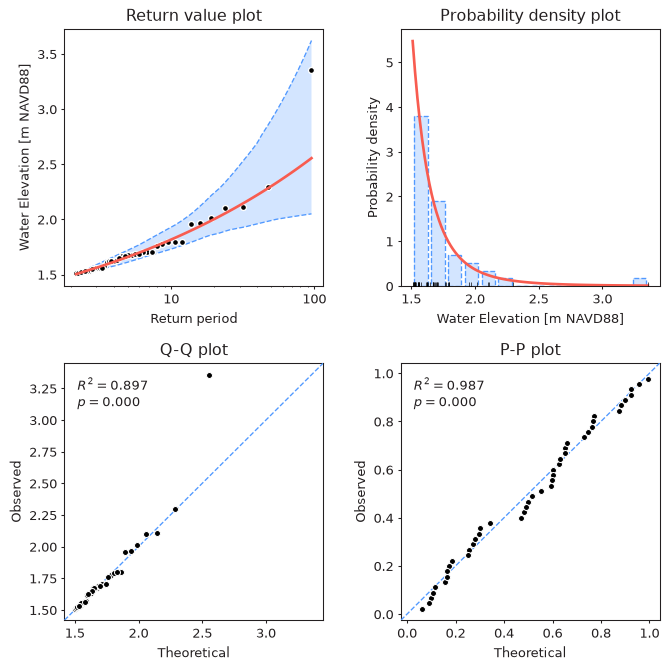
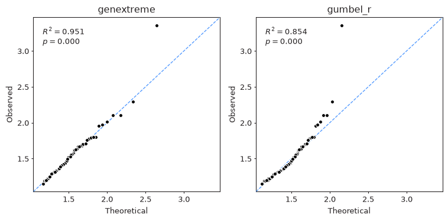
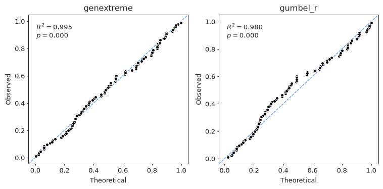

Before using return values, the fitted model should be checked visually.
A model with a low AIC or a narrow confidence interval may still describe
the data poorly, and plots are often the quickest way to notice that.

## Diagnostic Plot

The `plot_diagnostic` method combines the four most commonly used plots
in a single figure:

```python
from pyextremes import EVA

model = EVA(data=data)
model.get_extremes("POT", threshold=1.5, r="24h")
model.fit_model()
model.plot_diagnostic(alpha=0.95)
```

<figure markdown="span">
  
</figure>

??? note
    You can get the `data` variable referenced above by running the following code:

    ```python
    import pandas as pd

    data = pd.read_csv(
        "battery_wl.csv",
        index_col=0,
        parse_dates=True,
    ).squeeze()
    data = (
        data
        .sort_index(ascending=True)
        .astype(float)
        .dropna()
        .loc[pd.to_datetime("1925"):]
    )
    data = (
        data
        - (data.index.array - pd.to_datetime("1992"))
        / pd.to_timedelta("365.2425D")
        * 2.87e-3
    )
    ```

    `#!python "battery_wl.csv"`
    [can be downloaded here](https://github.com/georgebv/pyextremes-notebooks/tree/master/data).

The `plot_diagnostic` method uses the following parameters:

- **return_period** - return periods for which the return value plot is drawn.
  If None (default), 100 return periods are spaced uniformly within
  the range of return periods of the observed extreme values.
- **return_period_size** - size of return period, by default 1 year.
- **alpha** - confidence interval width in the range (0, 1).
  If None (default), confidence intervals are not shown.
- **plotting_position** - plotting position used to assign empirical probabilities
  to the observed extreme values, by default `#!python "weibull"`.
  See [Estimating Return Periods](6-return-periods.md#plotting-positions).
- **figsize** - figure size in inches in format (width, height), by default (8, 8).
- **kwargs** - model-specific arguments used to calculate confidence intervals:
  `n_samples` for `MLE`, `MOM`, and `Lmoments` models and `burn_in` for the
  `Emcee` model.

The method returns the figure and a tuple with the four axes
(return values, PDF, Q-Q, and P-P), which can be used to customize the plot.

## Components

### Return Value Plot

The top left plot shows modeled return values (red line), their confidence
interval (blue), and the observed extreme values (black dots) plotted at their
[empirical return periods](6-return-periods.md). It is also available on its own via
the `plot_return_values` method. A good model follows the observed values,
especially for the largest ones. A systematic departure of the largest observed
values from the curve indicates that the tail is not represented well.

### Probability Density Plot

The top right plot shows a histogram of the extreme values, the probability density
function of the fitted distribution (red line), and the individual extreme values
(black ticks at the bottom). This plot shows whether the overall shape of the
distribution is right, but it is not very informative about the tail,
where there are only a few observations.

### Q-Q Plot

The bottom left plot is a [quantile-quantile](https://en.wikipedia.org/wiki/Q%E2%80%93Q_plot)
(Q-Q) plot. Each observed extreme value (vertical axis) is plotted against the value
which the fitted distribution predicts for the same empirical exceedance
probability (horizontal axis). For a good model the points lie close to the
dashed diagonal line. Because it is drawn in the units of the data,
the Q-Q plot is the most sensitive of the four to problems in the tail.

The difference between a well-fitting and a poorly-fitting distribution is easy to
see when comparing GEVD and Gumbel fitted to the annual maxima
(see [Distributions](8-distributions.md#default-distribution)):

```python
model.plot_probability(plot_type="QQ")
```

<figure markdown="span">
  
</figure>

The Gumbel distribution can't represent the heavy upper tail of these data,
so the largest observed values lie well above the diagonal.
The largest value (Hurricane Sandy, 2012) is above the diagonal for both
distributions, which is expected for the single most extreme event in ~90 years.

### P-P Plot

The bottom right plot is a [probability-probability](https://en.wikipedia.org/wiki/P%E2%80%93P_plot)
(P-P) plot. It compares the empirical non-exceedance probability of each observed
value (vertical axis) with the probability given by the fitted cumulative
distribution function (horizontal axis):

```python
model.plot_probability(plot_type="PP")
```

<figure markdown="span">
  
</figure>

All probabilities are in the range [0, 1], so the P-P plot emphasizes the center
of the distribution and is much less sensitive to the tail: Gumbel shows only
a mild departure from the diagonal in the middle of the distribution, nothing
like the clear misfit of the largest values visible in its Q-Q plot.

!!! note
    The numbers in the top left corner of the Q-Q and P-P plots are the
    coefficient of determination $R^2$ (the square of the Pearson correlation
    coefficient between the theoretical and observed values) and the p-value $p$
    of the test for zero correlation.
    These numbers measure how well the points line up, not how close they are to
    the diagonal, and a small $p$ only means that the points are correlated.
    They are not a goodness-of-fit test - see [Goodness of Fit](15-goodness-of-fit.md).

The `plot_probability` method uses the following parameters:

- **plot_type** - `#!python "QQ"` for a Q-Q plot or `#!python "PP"` for a P-P plot.
- **return_period_size** - size of return period, by default 1 year.
- **plotting_position** - plotting position, by default `#!python "weibull"`.
- **ax** - matplotlib Axes object. If provided, the plot is drawn on this axes.
  If None (default), a new figure and axes are created.
- **figsize** - figure size in inches in format (width, height), by default (8, 8).

??? example "Code used to produce the figures above"

    ```python
    import matplotlib.pyplot as plt
    from pyextremes import EVA
    from pyextremes.plotting import pyextremes_rc

    models = {}
    for distribution in ["genextreme", "gumbel_r"]:
        models[distribution] = EVA(data=data)
        models[distribution].get_extremes("BM", block_size="365.2425D")
        models[distribution].fit_model(distribution=distribution)

    with plt.rc_context(rc=pyextremes_rc):
        fig, axes = plt.subplots(ncols=2, figsize=(8, 4), dpi=96)
        for ax, (distribution, model) in zip(axes, models.items()):
            model.plot_probability(plot_type="QQ", ax=ax)  # or "PP"
            ax.set_title(distribution)
        fig.tight_layout()
    ```

## Other Plots

Other plots described elsewhere in this guide:

- extreme values extracted from the time series - `plot_extremes`,
  see [Block Maxima](3-block-maxima.md) and
  [Peaks Over Threshold](4-peaks-over-threshold.md)
- threshold selection plots,
  see [Threshold Selection](5-threshold-selection.md)
- MCMC trace and corner plots - `plot_trace` and `plot_corner`,
  see [Markov Chain Monte Carlo](10-mcmc.md)

All plotting methods of `EVA` are built on functions from the `pyextremes.plotting`
module, which can be used directly with your own data
(see the [API Reference](../api/plotting.md)).
