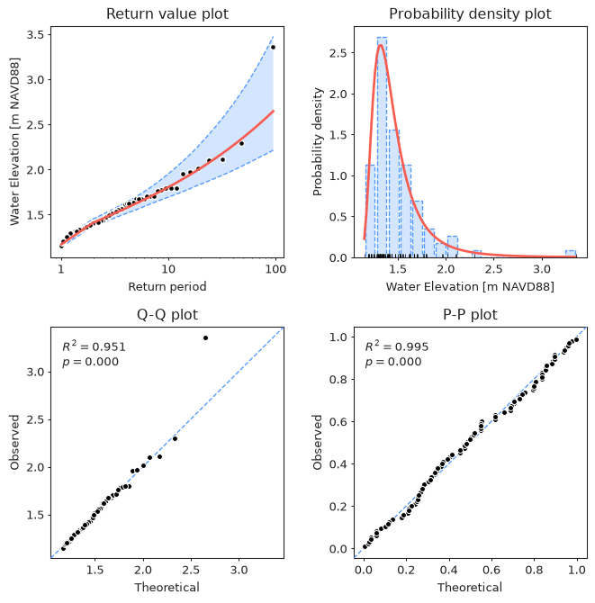

Once extreme values are extracted, the next step is to fit a statistical model to them.
Fitting a model means finding parameters of a continuous probability distribution
(e.g. shape, location, and scale of the GEVD) which best describe the observed
extreme values. The fitted distribution is then used to estimate return values
for return periods well beyond the length of the observed record
(e.g. a 100-year water level from 50 years of data).

In `pyextremes` a **model** is the method used to estimate distribution parameters
(e.g. MLE or MCMC), while a **distribution** is the probability distribution whose
parameters are estimated (e.g. GEVD or GPD). The two are chosen independently:
any supported model can be used with any continuous distribution.

## Available Models

| Model      | Method                     | Confidence intervals       | Section                                         |
| :--------- | :------------------------- | :------------------------- | :---------------------------------------------- |
| `MLE`      | Maximum Likelihood Estimate | bootstrap                  | [Maximum Likelihood](9-mle.md)                  |
| `Emcee`    | Markov Chain Monte Carlo   | posterior samples          | [Markov Chain Monte Carlo](10-mcmc.md)          |
| `MOM`      | Method of Moments          | bootstrap                  | [Moments and L-moments](11-moments.md)          |
| `Lmoments` | L-moments                  | bootstrap                  | [Moments and L-moments](11-moments.md)          |

`MLE` is the default model. It is fast, well understood, and is the method used
throughout the classic EVA literature (e.g. Coles, 2001).

!!! tip
    If you are not sure which model to use, start with the defaults (`MLE` and
    automatically selected distribution) and then use `Emcee` to check whether
    a Bayesian estimate agrees with the frequentist one.
    As discussed in [Extreme Value Types](2-extreme-value-types.md),
    different correctly applied methods should converge to similar answers.

## Fitting a Model

As outlined in the [Read First](1-read-first.md) section of this documentation,
there are multiple ways the same thing can be achieved in `pyextremes`.
A model can be fitted via:

- `pyextremes.get_model` - standalone function which takes a series of extreme values
  and returns a fitted model object
- `pyextremes.EVA.fit_model` - helper-class method
  (the model is not returned by this method, but instead is set
  on the `EVA` instance in the `.model` attribute)

The simplest way to fit a model is to use the default parameters:

=== "Standalone"

    ```python
    from pyextremes import get_extremes, get_model

    extremes = get_extremes(data, "BM", block_size="365.2425D")
    model = get_model(
        model="MLE",
        extremes=extremes,
        distribution="genextreme",
    )
    ```

=== "Using EVA"

    ```python
    from pyextremes import EVA

    model = EVA(data=data)
    model.get_extremes("BM", block_size="365.2425D")
    model.fit_model()
    ```

??? note
    You can get the `data` variable referenced above by running the following code:

    ```python
    import pandas as pd

    data = pd.read_csv(
        "battery_wl.csv",
        index_col=0,
        parse_dates=True,
    ).squeeze()
    data = (
        data
        .sort_index(ascending=True)
        .astype(float)
        .dropna()
        .loc[pd.to_datetime("1925"):]
    )
    data = (
        data
        - (data.index.array - pd.to_datetime("1992"))
        / pd.to_timedelta("365.2425D")
        * 2.87e-3
    )
    ```

    `#!python "battery_wl.csv"`
    [can be downloaded here](https://github.com/georgebv/pyextremes-notebooks/tree/master/data).

    All figures shown in the Fitting Models sections were generated using
    the code shown in these sections and the `data` defined above.

!!! warning
    The standalone `get_model` function fits the distribution to the extreme values
    exactly as provided. `EVA` performs a few extra steps behind the scenes:
    it selects the distribution automatically, fixes the location parameter
    for the GPD and Exponential distributions (see [Distributions](8-distributions.md)),
    and transforms extreme low values (`#!python extremes_type="low"`)
    so that they can be modeled using the same distributions as extreme high values.
    When working with extreme low values it is recommended to use `EVA`.

The `EVA.fit_model` method uses the following parameters:

- **model** - model name, one of `#!python "MLE"` (default), `#!python "Emcee"`,
  `#!python "MOM"`, or `#!python "Lmoments"`.
- **distribution** - name of a distribution from `scipy.stats`
  (e.g. `#!python "genextreme"`) or a `scipy.stats.rv_continuous` object.
  By default the distribution is selected automatically based on the extreme value
  extraction method. See [Distributions](8-distributions.md).
- **distribution_kwargs** - dictionary with distribution parameters to be held fixed,
  e.g. `#!python {"fc": 0}` or `#!python {"floc": 1.5}`.
  By default the location parameter is fixed for the GPD and Exponential
  distributions. See [Distributions](8-distributions.md).
- **kwargs** - additional keyword arguments passed to the model.
  Only the `Emcee` model accepts additional arguments:
  `n_walkers`, `n_samples`, `progress`, and `pool`.
  See [Markov Chain Monte Carlo](10-mcmc.md).

The standalone `get_model` function takes the same arguments,
except that it requires `extremes` and an explicit `distribution`,
and doesn't fix any parameters unless `distribution_kwargs` is provided.

!!! note
    Calling `fit_model` again replaces the previously fitted model.
    Extracting extreme values again (`get_extremes`) removes the fitted model,
    because it is no longer valid for the new extreme values.

## Inspecting the Model

Printing an `EVA` instance shows a summary of the data, extreme values,
and the fitted model:

=== "Code"

    ```python
    print(model)
    ```

=== "Output"

    ```
                               Univariate Extreme Value Analysis
    ========================================================================================
                                          Source Data
    ----------------------------------------------------------------------------------------
    Data label:    Water Elevation [m NAVD88]      Size:                             796,751
    Start:                      November 1926      End:                           March 2020
    ========================================================================================
                                         Extreme Values
    ----------------------------------------------------------------------------------------
    Count:                                 94      Extraction method:                     BM
    Type:                                high      Block size:             365 days 05:49:12
    ========================================================================================
                                             Model
    ----------------------------------------------------------------------------------------
    Model:                                MLE      Distribution:                  genextreme
    Log-likelihood:                    18.026      AIC:                              -29.786
    ----------------------------------------------------------------------------------------
    Free parameters:                 c=-0.266      Fixed parameters: All parameters are free
                                    loc=1.353
                                  scale=0.146
    ========================================================================================
    ```

The fitted model and its properties are available as attributes:

| Attribute                        | Description                                                        |
| :------------------------------- | :----------------------------------------------------------------- |
| `model.model`                    | fitted model object (`MLE`, `Emcee`, `MOM`, or `Lmoments`)         |
| `model.distribution`             | distribution with its free and fixed parameters                    |
| `model.model.fit_parameters`     | dictionary with fitted values of free parameters                   |
| `model.loglikelihood`            | log-likelihood of the fitted model                                 |
| `model.AIC`                      | corrected Akaike Information Criterion (smaller is better)         |

When using the standalone `get_model` function, the same attributes
(`distribution`, `fit_parameters`, `loglikelihood`, and `AIC`)
are available directly on the returned model object.

```python
print(model.model.fit_parameters)
```

```
{'c': np.float64(-0.2657081538950403), 'loc': np.float64(1.3530417941848183), 'scale': np.float64(0.14625409987106597)}
```

The quickest way to visually assess the fitted model is the diagnostic plot,
which shows the return value plot, the probability density histogram, and the
Q-Q and P-P plots (described in more detail in later sections):

```python
model.plot_diagnostic(alpha=0.95)
```

<figure markdown="span">
  
</figure>
