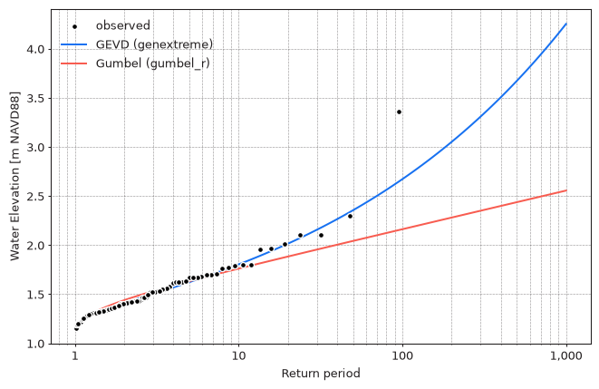
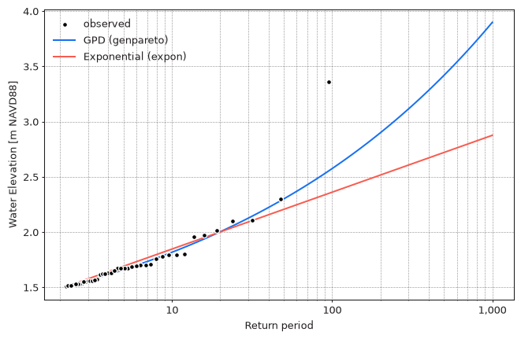

Extreme value theory tells us which distributions extreme values follow
asymptotically, as the block size or threshold grows:

- **Block Maxima** follow the Generalized Extreme Value Distribution (GEVD),
  per the [Fisher–Tippett–Gnedenko theorem](https://en.wikipedia.org/wiki/Fisher%E2%80%93Tippett%E2%80%93Gnedenko_theorem)
- **Peaks Over Threshold** follow the Generalized Pareto Distribution (GPD),
  per the [Pickands–Balkema–De Haan theorem](https://en.wikipedia.org/wiki/Pickands%E2%80%93Balkema%E2%80%93De_Haan_theorem)

Both distributions have a **shape** parameter which controls the behavior of the tail
(i.e. how quickly return values grow with return period).
When the shape parameter is zero, the GEVD reduces to the
[Gumbel distribution](https://en.wikipedia.org/wiki/Gumbel_distribution)
and the GPD reduces to the
[Exponential distribution](https://en.wikipedia.org/wiki/Exponential_distribution).
These are called **degenerate** cases: they have one parameter fewer
and therefore produce narrower confidence intervals, but they cannot represent
heavy (or bounded) tails.

`pyextremes` uses distributions from
[scipy.stats](https://docs.scipy.org/doc/scipy/reference/stats.html#continuous-distributions),
which are referred to by name:

| Distribution | `scipy.stats` name | Parameters        | Used with |
| :----------- | :----------------- | :---------------- | :-------- |
| GEVD         | `genextreme`       | `c`, `loc`, `scale` | BM      |
| Gumbel       | `gumbel_r`         | `loc`, `scale`    | BM        |
| GPD          | `genpareto`        | `c`, `loc`, `scale` | POT     |
| Exponential  | `expon`            | `loc`, `scale`    | POT       |

!!! warning "Sign of the shape parameter"
    Extreme value literature (e.g. Coles, 2001) uses the shape parameter $\xi$,
    where $\xi > 0$ corresponds to a heavy (unbounded) upper tail
    and $\xi < 0$ corresponds to a bounded upper tail.

    - `genpareto` uses the same convention: $c = \xi$.
    - `genextreme` uses the **opposite** convention: $c = -\xi$.
      For example, `c=-0.266` fitted below corresponds to $\xi = 0.266$,
      which is a heavy-tailed (Fréchet-type) distribution.

    Figures produced by `pyextremes` (e.g. MCMC trace and corner plots)
    label the shape parameter as $\xi$ but show the value of `scipy`'s `c`.

## Default Distribution

When the `distribution` argument of `EVA.fit_model` is not provided,
`pyextremes` fits two candidate distributions using the `MLE` model
and selects the one with the smallest
[Akaike Information Criterion](https://en.wikipedia.org/wiki/Akaike_information_criterion)
(AIC):

- `genextreme` or `gumbel_r` for extremes extracted using **Block Maxima**
- `genpareto` or `expon` for extremes extracted using **Peaks Over Threshold**
  (location parameter fixed at the threshold, see below)

The selected distribution is then fitted using the requested model.
The AIC used by `pyextremes` is corrected for small sample sizes (AICc):

$$AIC = 2k - 2\ln{\hat{L}} + \frac{2k^2 + 2k}{n - k - 1}$$

where $k$ is the number of free distribution parameters, $\hat{L}$ is the
maximized likelihood, and $n$ is the number of extreme values.
AIC rewards goodness of fit and penalizes the number of parameters,
so the degenerate distribution is selected unless the extra shape parameter
improves the fit enough to justify it.

For the annual maxima of the Battery water levels, GEVD is clearly preferred:

| Distribution | AIC     |
| :----------- | :------ |
| `genextreme` | -29.786 |
| `gumbel_r`   | -17.695 |

<figure markdown="span">
  
</figure>

For the POT extremes above a threshold of 1.5 m (`#!python r="24h"`, see
[Threshold Selection](5-threshold-selection.md)) the difference is much smaller,
but GPD is still preferred:

| Distribution | AIC     |
| :----------- | :------ |
| `genpareto`  | -42.985 |
| `expon`      | -41.776 |

<figure markdown="span">
  
</figure>

??? example "Code used to produce the figures above"

    ```python
    import matplotlib.pyplot as plt
    import numpy as np
    from pyextremes import EVA, get_return_periods
    from pyextremes.plotting import pyextremes_rc

    models = {}
    for label, distribution in [
        ("GEVD (genextreme)", "genextreme"),
        ("Gumbel (gumbel_r)", "gumbel_r"),
    ]:
        models[label] = EVA(data)
        models[label].get_extremes("BM", block_size="365.2425D")
        models[label].fit_model(distribution=distribution)
        print(distribution, models[label].AIC)

    observed = get_return_periods(
        ts=data,
        extremes=models["GEVD (genextreme)"].extremes,
        extremes_method="BM",
        extremes_type="high",
        block_size="365.2425D",
    )
    return_period = np.logspace(0.01, 3, 100)

    with plt.rc_context(rc=pyextremes_rc):
        fig, ax = plt.subplots(figsize=(8, 5), dpi=96)
        ax.semilogx()
        ax.grid(True, which="both")
        ax.xaxis.set_major_formatter(plt.FuncFormatter(lambda x, _: f"{x:,.0f}"))
        ax.scatter(
            observed["return period"],
            observed.iloc[:, 0],
            s=20,
            lw=1,
            facecolor="k",
            edgecolor="w",
            zorder=20,
            label="observed",
        )
        for label, model in models.items():
            return_value, _, _ = model.get_return_value(return_period)
            ax.plot(return_period, return_value, lw=1.5, label=label)
        ax.set_xlabel("Return period")
        ax.set_ylabel(data.name)
        ax.legend(loc="upper left")
    ```

    For POT the code is the same, with
    `#!python get_extremes("POT", threshold=1.5, r="24h")`,
    distributions `genpareto` and `expon`,
    and `#!python extremes_method="POT"` without `block_size`.

!!! info
    The automatic selection only chooses between a distribution and its degenerate
    case. It does not tell you whether the model is appropriate for your data -
    use the diagnostic plots and the stability checks described in
    [Threshold Selection](5-threshold-selection.md) for that.

## Selecting a Distribution

A distribution can be selected explicitly using the `distribution` argument:

=== "Standalone"

    ```python
    from pyextremes import get_extremes, get_model

    extremes = get_extremes(data, "BM", block_size="365.2425D")
    model = get_model(
        model="MLE",
        extremes=extremes,
        distribution="gumbel_r",
    )
    ```

=== "Using EVA"

    ```python
    from pyextremes import EVA

    model = EVA(data=data)
    model.get_extremes("BM", block_size="365.2425D")
    model.fit_model(distribution="gumbel_r")
    ```

Any continuous distribution from `scipy.stats` can be used, either by name
or by passing the distribution object (e.g. `#!python scipy.stats.genextreme`).
Custom distributions can be provided by subclassing
[scipy.stats.rv_continuous](https://docs.scipy.org/doc/scipy/reference/generated/scipy.stats.rv_continuous.html)
and passing an instance of the subclass.

!!! warning
    `EVA` issues a `RuntimeWarning` when a distribution other than `genextreme`
    or `gumbel_r` is used with Block Maxima, or other than `genpareto` or `expon`
    is used with Peaks Over Threshold. Other distributions (e.g. `weibull_min`
    or `lognorm`) may fit the observed data well, but they have no theoretical
    justification for extrapolating to rare events.

## Fixing Parameters

Any distribution parameter can be fixed (frozen) to a given value,
in which case only the remaining (free) parameters are fitted.
Fixed parameters are passed via the `distribution_kwargs` argument
with names prefixed with `f`:

- **fc** - shape parameter(s), named after the parameter
  (`c` for `genextreme` and `genpareto`)
- **floc** - location parameter
- **fscale** - scale parameter

One use of this feature is to investigate degenerate models.
For example, GEVD with a shape parameter fixed at 0 is the Gumbel distribution:

=== "Code"

    ```python
    model.fit_model(
        distribution="genextreme",
        distribution_kwargs={"fc": 0},
    )
    print(model.model)
    ```

=== "Output"

    ```
                   MLE model
    ---------------------------------------
    free parameters: loc=1.376, scale=0.171
    fixed parameters: fc=0.000
    AIC: -17.695
    loglikelihood: 10.913
    return value cache size: 0
    fit parameter cache size: 0
    ---------------------------------------
    ```

The fitted location and scale parameters, log-likelihood, and AIC are identical
to those of `gumbel_r`.

### Location Parameter in POT

Exceedances over a threshold can't be smaller than the threshold itself,
so the location parameter of the GPD and Exponential distributions
is equal to the threshold by definition. Because of this, when a `genpareto` or
`expon` distribution is fitted using `EVA` and `distribution_kwargs` is not
provided, the location parameter is fixed:

- at the threshold for extremes extracted using Peaks Over Threshold
- at the smallest extreme value for extremes extracted using Block Maxima

This leaves only the shape and scale parameters to be fitted:

=== "Default (floc fixed)"

    ```python
    model = EVA(data=data)
    model.get_extremes("POT", threshold=1.5, r="24h")
    model.fit_model(distribution="genpareto")
    print(model.model)
    ```

    ```
                  MLE model
    -------------------------------------
    free parameters: c=0.242, scale=0.169
    fixed parameters: floc=1.500
    AIC: -42.985
    loglikelihood: 23.639
    return value cache size: 0
    fit parameter cache size: 0
    -------------------------------------
    ```

=== "All parameters free"

    ```python
    model = EVA(data=data)
    model.get_extremes("POT", threshold=1.5, r="24h")
    model.fit_model(distribution="genpareto", distribution_kwargs={})
    print(model.model)
    ```

    ```
                       MLE model
    ------------------------------------------------
    free parameters: c=0.255, loc=1.511, scale=0.153
    fixed parameters: all parameters are free
    AIC: -46.673
    loglikelihood: 26.636
    return value cache size: 0
    fit parameter cache size: 0
    ------------------------------------------------
    ```

To fit all parameters freely, pass an empty dictionary
(`#!python distribution_kwargs={}`). Providing any `distribution_kwargs`
replaces the default, so `#!python {"fc": 0}` for `genpareto` would leave
the location parameter free.

!!! note
    The `Lmoments` model doesn't support fixed parameters,
    so the location parameter is never fixed when using it.
    See [Moments and L-moments](11-moments.md).
