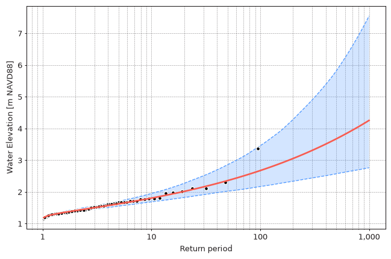
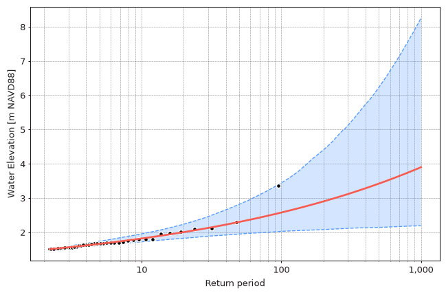

[Maximum Likelihood Estimation](https://en.wikipedia.org/wiki/Maximum_likelihood_estimation)
(MLE) finds distribution parameters $\theta$ which make the observed extreme values
$x_1, \dots, x_n$ most probable. This is done by maximizing the log-likelihood function:

$$\ell(\theta) = \sum_{i=1}^{n} \ln{f(x_i \mid \theta)}$$

where $f$ is the probability density function of the distribution.
MLE is the default model in `pyextremes` and is the method used throughout
the classic EVA literature. It is fast, works with any continuous distribution,
and supports fixing any combination of distribution parameters.
Under the hood, `pyextremes` uses the `fit` method of
[scipy.stats.rv_continuous](https://docs.scipy.org/doc/scipy/reference/generated/scipy.stats.rv_continuous.fit.html).

## Fitting the Model

=== "Standalone"

    ```python
    from pyextremes import get_extremes, get_model

    extremes = get_extremes(data, "BM", block_size="365.2425D")
    model = get_model(
        model="MLE",
        extremes=extremes,
        distribution="genextreme",
    )
    ```

=== "Using EVA"

    ```python
    from pyextremes import EVA

    model = EVA(data=data)
    model.get_extremes("BM", block_size="365.2425D")
    model.fit_model(model="MLE")
    ```

??? note
    You can get the `data` variable referenced above by running the following code:

    ```python
    import pandas as pd

    data = pd.read_csv(
        "battery_wl.csv",
        index_col=0,
        parse_dates=True,
    ).squeeze()
    data = (
        data
        .sort_index(ascending=True)
        .astype(float)
        .dropna()
        .loc[pd.to_datetime("1925"):]
    )
    data = (
        data
        - (data.index.array - pd.to_datetime("1992"))
        / pd.to_timedelta("365.2425D")
        * 2.87e-3
    )
    ```

    `#!python "battery_wl.csv"`
    [can be downloaded here](https://github.com/georgebv/pyextremes-notebooks/tree/master/data).

The MLE model takes no additional arguments.
See [Overview](7-models.md) and [Distributions](8-distributions.md)
for the `distribution` and `distribution_kwargs` arguments.

## Confidence Intervals

MLE produces a single best estimate of distribution parameters.
To estimate uncertainty of return values, `pyextremes` uses
[bootstrap resampling](https://en.wikipedia.org/wiki/Bootstrapping_(statistics)):

1. draw a random sample of the same size as the extreme values,
   with replacement, from the extreme values
2. fit the distribution to this sample (keeping fixed parameters fixed)
3. repeat `n_samples` times and calculate return values for each set
   of fitted parameters
4. take quantiles of these return values as confidence interval bounds
   (e.g. 2.5% and 97.5% for `#!python alpha=0.95`)

Confidence intervals are calculated when the `alpha` argument (confidence interval
width) is passed to `get_summary`, `get_return_value`, `plot_return_values`,
or `plot_diagnostic`. The number of bootstrap samples is controlled using the
`n_samples` argument (by default 100):

=== "Block Maxima"

    ```python
    summary = model.get_summary(
        return_period=[2, 5, 10, 25, 50, 100, 250, 500, 1000],
        alpha=0.95,
        n_samples=1000,
    )
    print(summary)
    ```

    ```
                   return value  lower ci  upper ci
    return period
    2.0                1.409343  1.371733  1.453128
    5.0                1.622565  1.551648  1.701924
    10.0               1.803499  1.685524  1.949140
    25.0               2.090267  1.870731  2.399169
    50.0               2.354889  2.020307  2.854903
    100.0              2.671313  2.167416  3.456198
    250.0              3.188356  2.392412  4.615462
    500.0              3.671580  2.569467  5.815670
    1000.0             4.252220  2.759888  7.544389
    ```

=== "Peaks Over Threshold"

    ```python
    model = EVA(data=data)
    model.get_extremes("POT", threshold=1.5, r="24h")
    model.fit_model()
    summary = model.get_summary(
        return_period=[5, 10, 25, 50, 100, 250, 500, 1000],
        alpha=0.95,
        n_samples=1000,
    )
    print(summary)
    ```

    ```
                   return value  lower ci  upper ci
    return period
    5.0                1.660715  1.612644  1.736490
    10.0               1.817443  1.718713  1.953821
    25.0               2.069458  1.855135  2.353410
    50.0               2.300945  1.945796  2.817342
    100.0              2.574771  2.024709  3.441693
    250.0              3.015076  2.096636  4.794305
    500.0              3.419515  2.142378  6.232265
    1000.0             3.897927  2.188766  8.248706
    ```

The same arguments are used to plot return values with confidence intervals:

```python
import numpy as np

model.plot_return_values(
    return_period=np.logspace(0.01, 3, 100),
    return_period_size="365.2425D",
    alpha=0.95,
    n_samples=1000,
)
```

=== "Block Maxima"

    <figure markdown="span">
      
    </figure>

=== "Peaks Over Threshold"

    <figure markdown="span">
      
    </figure>

!!! tip "Return periods shorter than the extremes rate"
    Return values can only be calculated for return periods longer than the average
    interval between extreme events. In the POT example above there are 44 extreme
    values in ~93 years, so the shortest valid return period is ~2.1 years and a 2-year
    return value is `-inf`. Block Maxima with 1-year blocks have exactly one extreme
    value per year, so any return period longer than 1 year is valid.

!!! info "Caching"
    Bootstrap samples are expensive to compute, so fitted parameters are cached
    on the model and reused by subsequent calls. Requesting more samples
    (e.g. `#!python n_samples=1000` after `#!python n_samples=100`) only computes
    the missing ones. Calculated return values are cached as well.
    Both caches are discarded when the model is refitted.

!!! warning "Running as a script"
    When more than 50 new bootstrap samples are needed, they are calculated in
    parallel using `multiprocessing`. When running pyextremes from a Python script
    (as opposed to a Jupyter notebook), protect the entry point of your script with an
    `#!python if __name__ == "__main__":` block.
    See [Quick Start](../quickstart.md#calculate-return-values) for more details.

Bootstrap confidence intervals depend on random samples, so they will be slightly
different every time they are calculated. Larger `n_samples` values produce more
stable confidence intervals at the cost of computation time.
